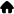
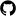
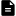

  
I am an integrated M.S./Ph.D. student of KAIST <a href="https://cvlab.kaist.ac.kr">CVLAB</a> under Prof. Seungryong Kim and a research intern at Naver Cloud, with a focus on generative world modeling.

  
My research interests lie at the intersection of computer vision and embodied agents, focusing on developing semantically rich perception and generative models to advance robot perception and world modeling.

  
If you have any questions or suggestions, please feel free to contact me via email (<a href="mailto:kchyun@kaist.ac.kr">kchyun@kaist.ac.kr</a>) or <a href="https://www.linkedin.com/in/kchyun0910">LinkedIn</a>!

## Publications





  

    

      
  
      
        
No Image

      
  

          
            
          
          
            
          
          
            
          
        

      

      

      <h3 style="margin:0 0 6px; font-size:1.05rem; line-height:1.3;">{{ p.title }}</h3>
      
{{ p.authors }}

      
        
<i>{{ p.venue }}</i>

      
    

  



<!-- Click-to-zoom Lightbox -->
<link rel="stylesheet" href="{{ '/assets/css/custom-lightbox.css' | relative_url }}">

