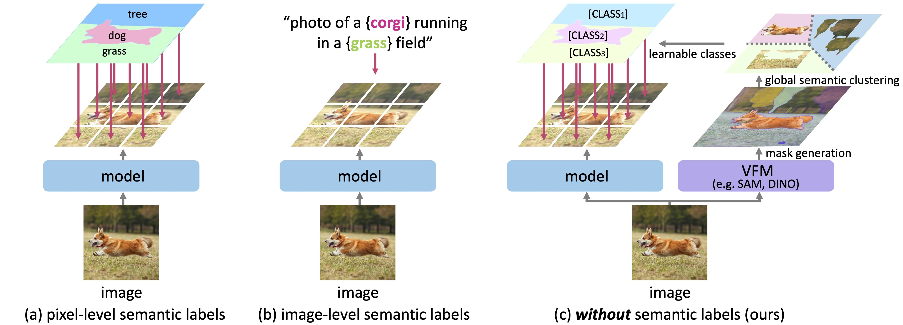

    
    

        <h2 style="margin-top:0;">Towards open-vocabulary semantic segmentation without semantic labels</h2>
        
Heeseong Shin, <strong>Chaehyun Kim</strong>, Sunghwan Hong, Seokju Cho, Anurag Arnab, Paul Hongsuck Seo, and Seungryong Kim.

        
NeurIPS2024

        

        <a href="https://arxiv.org/abs/2409.19846" style="display:inline-block; padding:6px 16px; background:#007bff; color:#fff; border-radius:4px; text-decoration:none; margin-right:8px;">Arxiv Link</a>
        <a href="https://cvlab-kaist.github.io/PixelCLIP" style="display:inline-block; padding:6px 16px; background:#28a745; color:#fff; border-radius:4px; text-decoration:none;">Project Page</a>
        

    

    