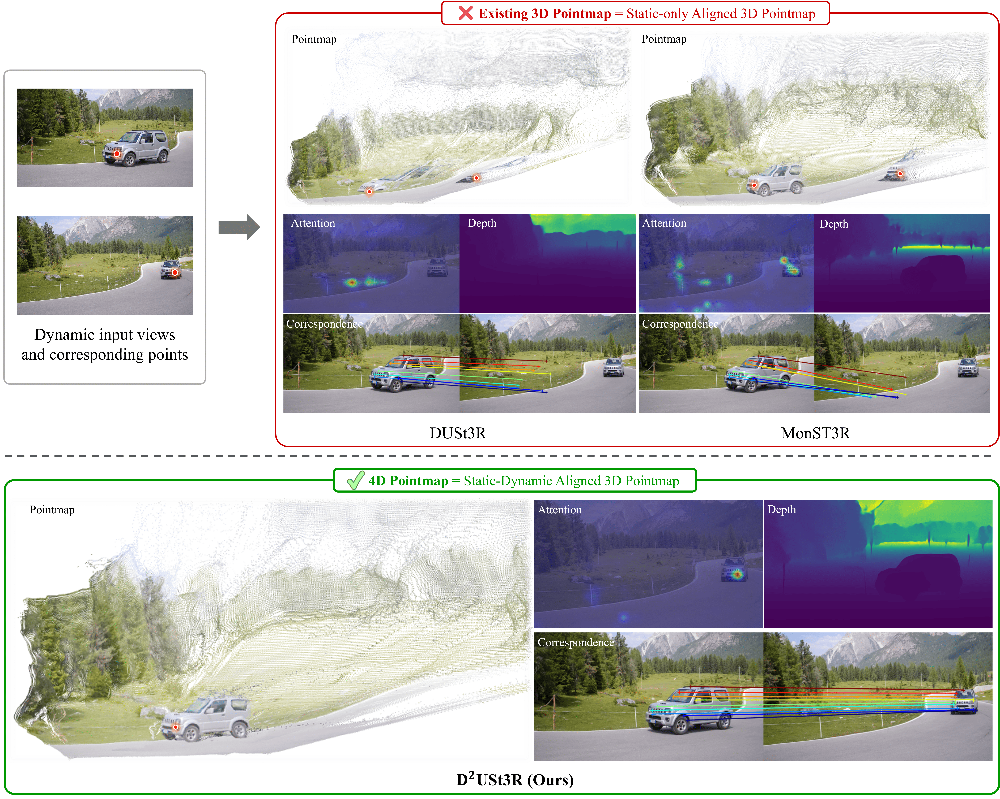

    
    

        <h2 style="margin-top:0;">D2USt3R: Enhancing 3D Reconstruction with 4D Pointmaps for Dynamic Scenes</h2>
        
Jisang Han, Honggyu An, Jaewoo Jung, Takuya Narihira, Junyoung Seo, Kazumi Fukuda, <strong>Chaehyun Kim</strong>, Sunghwan Hong, Yuki Mitsufuji, and Seungryong Kim.

        
In Advances in Neural Information Processing Systems (NeurIPS), 2025

        

        <a href="https://arxiv.org/abs/2504.06264" style="display:inline-block; padding:6px 16px; background:#007bff; color:#fff; border-radius:4px; text-decoration:none; margin-right:8px;">Arxiv Link</a>
        <a href="https://cvlab-kaist.github.io/DDUSt3R/" style="display:inline-block; padding:6px 16px; background:#28a745; color:#fff; border-radius:4px; text-decoration:none;">Project Page</a>
        

    

    