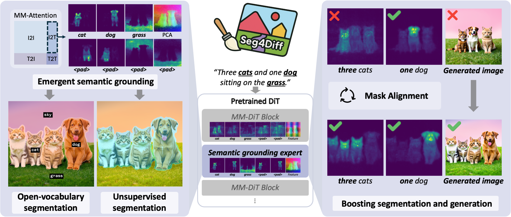

    
    

        <h2 style="margin-top:0;">Seg4Diff: Unveiling Open-Vocabulary Segmentation in Text-to-Image Diffusion Transformers</h2>
        
<strong>Chaehyun Kim</strong>, Heeseong Shin, Eunbeen Hong, Heeji Yoon, Anurag Arnab, Paul Hongsuck Seo, Sunghwan Hong, Seungryong Kim

        
In Advances in Neural Information Processing System (NeurIPS), 2025

        

        <a href="https://arxiv.org/abs/2509.18096" style="display:inline-block; padding:6px 16px; background:#007bff; color:#fff; border-radius:4px; text-decoration:none; margin-right:8px;">Arxiv Link</a>
        <a href="https://cvlab-kaist.github.io/Seg4Diff/" style="display:inline-block; padding:6px 16px; background:#28a745; color:#fff; border-radius:4px; text-decoration:none;">Project Page</a>
        

    

    