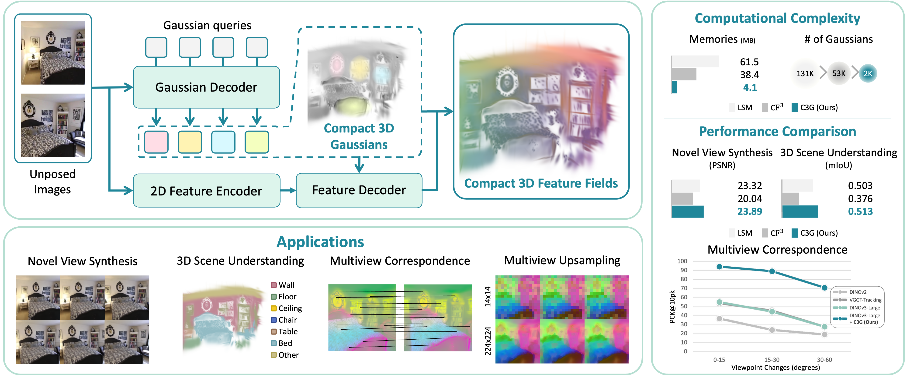

    
    

        <h2 style="margin-top:0;">C3G: Learning Compact 3D Representations with 2K Gaussians</h2>
        
Honggyu An, Jaewoo Jung, Mungyeom Kim, Sunghwan Hong, <strong>Chaehyun Kim</strong>, Kazumi Fukuda, Minkyeong Jeon, Jisang Han, Takuya Narihira, Hyuna Ko, Junsu Kim, Yuki Mitsufuji, Seungryong Kim

        
Arxiv, 2025

        

        <a href="https://arxiv.org/abs/2512.04021" style="display:inline-block; padding:6px 16px; background:#007bff; color:#fff; border-radius:4px; text-decoration:none; margin-right:8px;">Arxiv Link</a>
        <a href="https://cvlab-kaist.github.io/C3G/" style="display:inline-block; padding:6px 16px; background:#28a745; color:#fff; border-radius:4px; text-decoration:none;">Project Page</a>
        

    

    