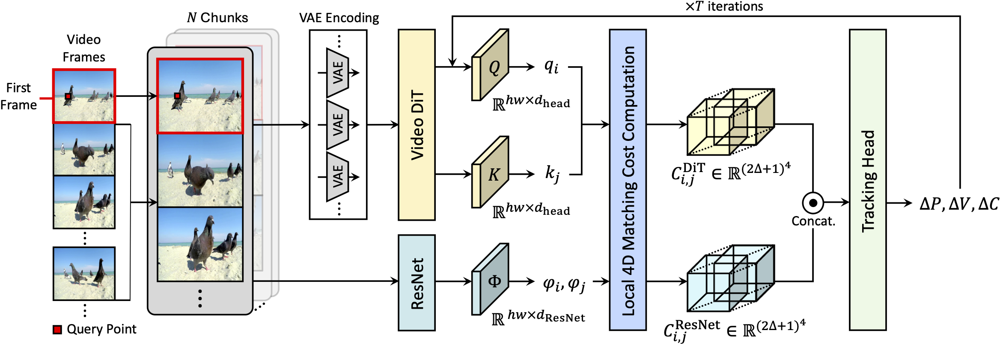

    
    

        <h2 style="margin-top:0;">Repurposing Video Diffusion Transformers for Robust Point Tracking</h2>
        
Soowon Son, Honggyu An, <strong>Chaehyun Kim</strong>, Hyunah Ko, Jisu Nam, Dahyun Chung, Siyoon Jin, Jung Yi, Jaewon Min, Junhwa Hur, Seungryong Kim

        
Arxiv, 2025

        

        <a href="https://arxiv.org/abs/2512.20606" style="display:inline-block; padding:6px 16px; background:#007bff; color:#fff; border-radius:4px; text-decoration:none; margin-right:8px;">Arxiv Link</a>
        <a href="https://cvlab-kaist.github.io/DiTracker/" style="display:inline-block; padding:6px 16px; background:#28a745; color:#fff; border-radius:4px; text-decoration:none;">Project Page</a>
        

    

    