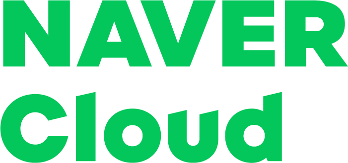

<!-- Profile Header -->

  

    
  

  

    <h1>Chaehyun Kim</h1>
    
M.S./Ph.D. Integrated Student · CVLAB, KAIST

    

      <a href="mailto:kchyun@kaist.ac.kr"><i class="fas fa-envelope"></i> kchyun@kaist.ac.kr</a>
      <a href="https://scholar.google.com/citations?user=qTKC_2cAAAAJ&hl=en" target="_blank" rel="noopener">
        <i class="ai ai-google-scholar"></i> Google Scholar
      </a>
      <a href="https://github.com/kchyun" target="_blank" rel="noopener">
        <i class="fab fa-github"></i> GitHub
      </a>
      <a href="https://www.linkedin.com/in/kchyun0910" target="_blank" rel="noopener">
        <i class="fab fa-linkedin"></i> LinkedIn
      </a>
    

  

<!-- Intro -->

  
I am an integrated M.S./Ph.D. student at <a href="https://cvlab.kaist.ac.kr">KAIST CVLAB</a>, advised by Prof. Seungryong Kim, and currently a research intern at NVIDIA Research Taiwan. Previously, I was a research intern at Naver Cloud.

  
My research interests lie at the intersection of computer vision and embodied agents, focusing on developing semantically and geometrically rich vision models to advance robot perception and world modeling.

  
If you have any questions or suggestions, please feel free to contact me via email (<a href="mailto:kchyun@kaist.ac.kr">kchyun@kaist.ac.kr</a>) or <a href="https://www.linkedin.com/in/kchyun0910">LinkedIn</a>!

## Experience

<!--
  Logo files go in images/logos/.
  Set the src of each .exp-logo img to match your filename.
  Recommended size: ~120px wide, any height (auto-scaled).
-->

<ul class="cv-list exp-grid">
  <li class="exp-item">
    

      

        
      

      

        
NVIDIA Research Taiwan

        
Research Intern

        
2026.04 – Now

      

    

  </li>
  <li class="exp-item">
    

      

        
      

      

        
Naver Cloud

        
Research Intern

        
2025.10 – 2026.04

      

    

  </li>
</ul>

## Publications



  

    

      
        
      
        
No Image

      
      

        
          
        
        
          
        
        
          
        
      

    

    

      <h3>{{ p.title }}</h3>
      
{{ p.authors }}

      
{{ p.venue }}

    

  



## Education

<ul class="cv-list">
  <li>
    M.S. / Ph.D Integrated Student @ Korea Advanced Institute of Science &amp; Technology (KAIST)
    <ul>
      <li>Kim Jaechul Graduate School of AI, CVLAB (PI: Prof. Seungryong Kim)</li>
      <li>2024.09 – 2029 (expected)</li>
    </ul>
  </li>
  <li>
    B.S. at Korea University
    <ul>
      <li>Computer Science &amp; Engineering</li>
      <li>2020.03 – 2024.08 · Graduated Magna Cum Laude</li>
    </ul>
  </li>
</ul>

## Academic Service

<!--
  HOW TO ADD ACADEMIC SERVICE ENTRIES:
  Each entry is a <li> inside the <ul class="cv-list"> below.
  Use this structure for each role:

  <li>
    Role · Conference/Journal Name · Year
    <ul>
      <li>Optional detail (e.g. number of papers reviewed)</li>
    </ul>
  </li>

  Common roles: Reviewer, Program Committee Member, Area Chair,
  Workshop Organizer, Session Chair, etc.

  Example:
  <li>
    Reviewer · NeurIPS 2025
  </li>
  <li>
    Reviewer · CVPR, ICCV, ECCV · 2025
  </li>
-->

<ul class="cv-list">
  <li>Reviewer · AAAI · 2026</li>
  <li>Reviewer · ECCV · 2026</li>
</ul>

## Honors &amp; Awards

<ul class="cv-list">
  <li>STX Scholarship · 2022.03
    <ul><li>Issued by STX Foundation</li></ul>
  </li>
  <li>The National Scholarship for Science and Engineering · 2022.03
    <ul><li>Issued by KOSAF (Korea Student Aid Foundation)</li></ul>
  </li>
  <li>Merit Based Scholarship · 2021.01
    <ul><li>Issued by Suwon-si</li></ul>
  </li>
</ul>
